# Authoring dei contenuti e-mail

In [!DNL Adobe Marketo Optimizer], lo spazio di progettazione delle e-mail fornisce un&#39;area di lavoro visiva in cui gli addetti al marketing compongono le e-mail. Gli strumenti di progettazione delle e-mail nei pannelli sinistro e superiore (strutture, componenti di contenuto, modelli, frammenti e altro ancora) supportano la creazione da zero con il trascinamento della selezione. Puoi anche scegliere di iniziare da un modello, incollare HTML non elaborati o assemblare messaggi da frammenti visivi riutilizzabili.

>[!PREREQUISITES]
>
>L&#39;authoring di e-mail richiede le [autorizzazioni](../start/permissions-reference.md) seguenti:
>
>* **[!UICONTROL Visualizza e-mail B2B]**: obbligatorio per visualizzare i messaggi e-mail.
>* **[!UICONTROL Gestisci e-mail B2B]**: necessario per creare, modificare ed eliminare i messaggi e-mail.

In [!DNL Marketo Optimizer], un&#39;e-mail è una risorsa indipendente [creata in un programma o in una cartella](../marketing/email-channel.md#create-email-from-programs), quindi [pubblicata e selezionata in un percorso](../marketing/email-channel.md#lifecycle). Definisci innanzitutto le _proprietà_ e le _azioni_. Poi definisci il contenuto.

Fai clic su **[!UICONTROL Modifica corpo dell&#39;e-mail]** per avviare lo spazio di progettazione del corpo dell&#39;e-mail, dove puoi scegliere come progettare l&#39;e-mail dalle seguenti opzioni:

* [Progetta il tuo messaggio e-mail da zero](#design-from-scratch) utilizzando l&#39;interfaccia di progettazione visiva. Crea il componente layout e-mail per componente trascinando la selezione su un’area di lavoro vuota. Questo metodo è ideale per creare nuovi modelli o e-mail una tantum.

* [Importa il contenuto HTML esistente](#import-html-content) nell&#39;editor di codice o lavora fianco a fianco con l&#39;area di lavoro visiva.

* [Selezionare un modello esistente](#templates) da un elenco di modelli di posta elettronica predefiniti o personalizzati. Questo metodo è ideale per i casi di utilizzo di e-mail ripetibili.

<!-- * Upload a design prototype (JPG, PNG, PDF, or Figma export) and have Coworker convert it into a responsive HTML email. (Image to HTML (Img2HTML) -->

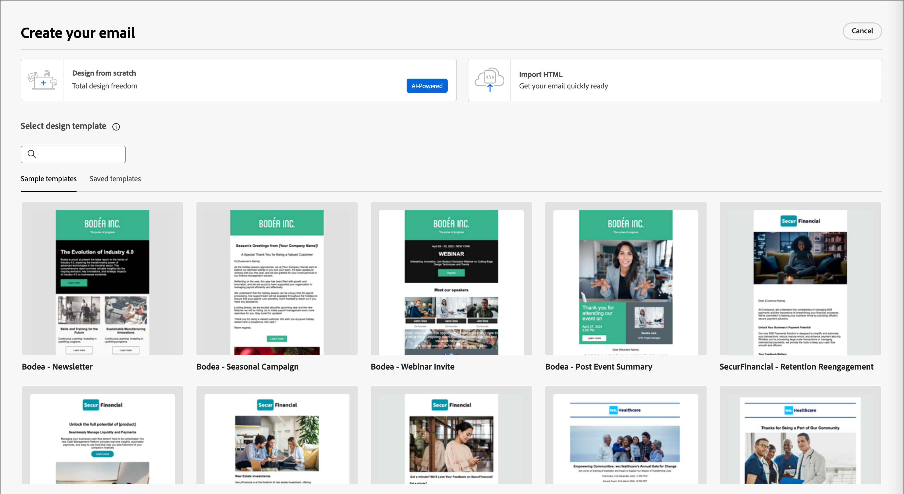{width="800" zoomable="yes"}

## Strumenti di progettazione e-mail {#email-design-tools}

* **Barra degli strumenti superiore:** Salva, Indietro, Passa all&#39;editor di codice, controlli di anteprima.
* **Pannello sinistro:** strutture (layout colonne), contenuto (testo, pulsante, immagine, divisore, social, HTML), frammenti, modelli, struttura di navigazione (gerarchia DOM dell&#39;e-mail).
* **Area di lavoro centrale:** editor WYSIWYG con anteprima desktop e mobile.
* **Pannello a destra:** impostazioni e stili per il componente attualmente selezionato, incluse le proprietà del contenuto, lo sfondo, il bordo, la spaziatura interna e la personalizzazione.

>[!BEGINSHADEBOX]

## Best practice per la progettazione e-mail {#design-best-practices}

L’aderenza alle best practice HTML e CSS consente di garantire un rendering coerente tra i client e-mail.

| Approccio | Linee guida |
| -------- | -------- |
| **Consigliato** | Layout statici basati su tabelle · Tabelle HTML e tabelle nidificate · Larghezze dei modelli di 600-800 px · CSS in linea semplice · Font Web-safe |
| **Usare con cautela** | Immagini di sfondo (supporto client limitato) · Font web personalizzati (definiscono sempre un font di fallback) · Layout di dimensioni superiori a 800 px · Mappe immagine |
| **Evita** | JavaScript, iframe o Flash · Audio o video incorporati · HTML Form · Layout basati su Div |

>[!NOTE]
>
>Il contenuto dell’e-mail deve inoltre soddisfare i requisiti di accessibilità digitale applicabili. Strutturare le intestazioni in modo logico, fornire testo alternativo per tutte le immagini e verificare il contrasto dei colori in modalità chiara e scura.

>[!ENDSHADEBOX]

## Creare e-mail da zero {#design-from-scratch}

Utilizza lo spazio di progettazione del contenuto visivo per definire la struttura e il contenuto dell’e-mail. Aggiungendo e spostando componenti strutturali con semplici azioni di trascinamento della selezione, puoi progettare il layout e l’organizzazione del contenuto dell’e-mail in pochi secondi.

1. Dalla pagina _[!UICONTROL Crea messaggio e-mail]_, seleziona l&#39;opzione **[!UICONTROL Progetta da zero]**.

1. Nella finestra di dialogo _[!UICONTROL Crea e-mail]_, scegli il tipo di contenuto e-mail che desideri creare.

   * **[!UICONTROL Usa temi]** - Scegliere questa opzione per creare l&#39;e-mail in _modalità tema_. In questa modalità, puoi utilizzare un tema del brand definito per semplificare il processo di authoring dei contenuti e assicurarti che la progettazione sia allineata agli standard definiti.

   * **[!UICONTROL Stile manuale]** - Scegliere questa opzione per creare l&#39;e-mail in _Modalità manuale_. In questa modalità, puoi impostare manualmente lo stile per tutti i componenti di struttura e contenuto aggiunti all’area di lavoro vuota.

   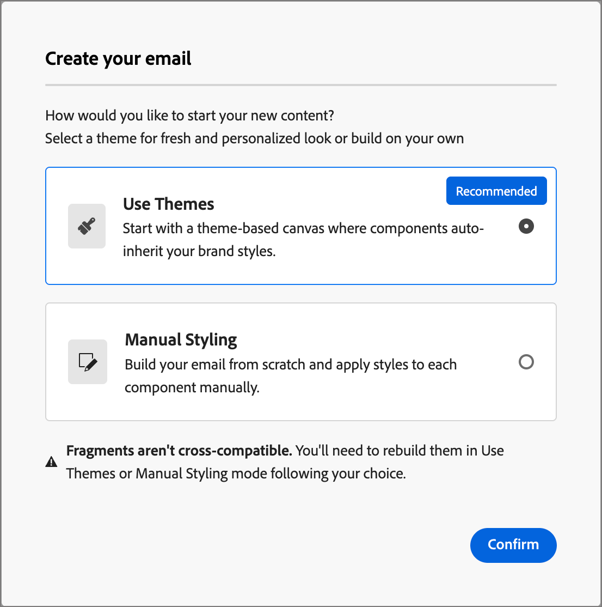{width="450"}

1. [Aggiungi componenti struttura e contenuto](#structure-content) nell&#39;area di lavoro.

1. [Rivedi e aggiorna i collegamenti](#preview-and-edit-linked-urls).

1. [Verifica e-mail](#check-and-test-the-email).

Quando si è soddisfatti del contenuto, fare clic su **[!UICONTROL Salva]**.

## Importa contenuto HTML esistente {#import-html-content}

Il contenuto importato può essere:

* Un file HTML con un foglio di stile incorporato
* Un file .zip che include un file HTML, il foglio di stile (.css) e le immagini

  >[!NOTE]
  >
  >La struttura del file .zip non è soggetta a specifici vincoli. Tuttavia, i riferimenti devono essere relativi e adattarsi alla struttura ad albero della cartella .zip. Le immagini vengono sempre caricate nell&#39;archivio [assets](./digital-asset-management.md).

_Per importare un file contenente contenuto HTML :_

1. Nella home page di progettazione selezionare l&#39;opzione **[!UICONTROL Importa HTML]**.

1. Trascina il file HTML o .zip con il contenuto HTML e fai clic su **[!UICONTROL Importa]**.

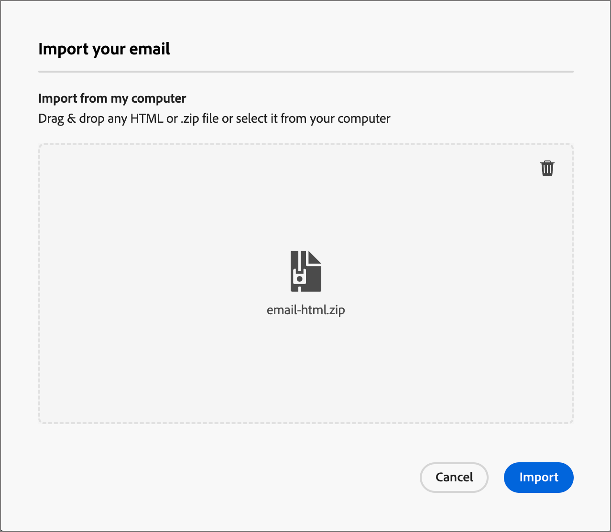{width="500"}

>[!NOTE]
>
>L’utilizzo di un tag `<table>` come primo livello in un file HTML può causare la perdita di stile, incluse le impostazioni di sfondo e larghezza nel tag del livello superiore.

Puoi personalizzare il contenuto importato in base alle esigenze con gli strumenti dell’editor e-mail visivo.

## Seleziona un modello {#templates}

Quando apri lo spazio di progettazione delle e-mail, utilizza la sezione **[!UICONTROL Seleziona modello di progettazione]** per iniziare da un modello di esempio incorporato o da un modello personalizzato salvato. Vedi [Utilizzare un modello in un messaggio e-mail](./templates.md#use-in-journey) per il flusso di lavoro completo.

Puoi scegliere tra:

* **Modelli di esempio** - Modelli e-mail incorporati forniti da Adobe.
* **Modelli salvati** - Modelli personalizzati creati da zero o salvati da contenuti e-mail esistenti.

>[!BEGINTABS]

>[!TAB Modelli salvati]

Nella pagina _[!UICONTROL Crea messaggio e-mail]_, la scheda _[!UICONTROL Modelli di esempio]_ è selezionata per impostazione predefinita. Per utilizzare un modello personalizzato, selezionare la scheda **[!UICONTROL Modelli salvati]**.

>[!NOTE]
>
>Ai modelli salvati possono essere applicate le impostazioni di governance (blocco del contenuto) a uno o più componenti. Lo spazio di progettazione visivo fornisce indicazioni sui componenti bloccati quando si [crea un messaggio e-mail da un modello gestito](./template-content-governance.md).

L’elenco mostra tutti i modelli e-mail creati nella sandbox corrente. Puoi ordinarli per **[!UICONTROL Nome]**, **[!UICONTROL Ultima modifica]** e **[!UICONTROL Ultima creazione]**.

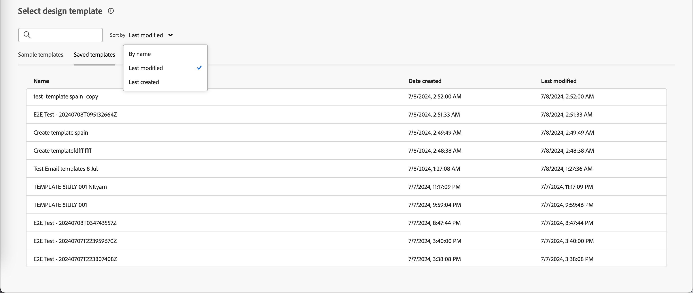{width="800" zoomable="yes"}

Selezionare dall&#39;elenco il modello che si desidera visualizzare in anteprima. In modalità anteprima, utilizza le frecce destra e sinistra per spostarti tra i modelli della categoria selezionata (campione o salvato).

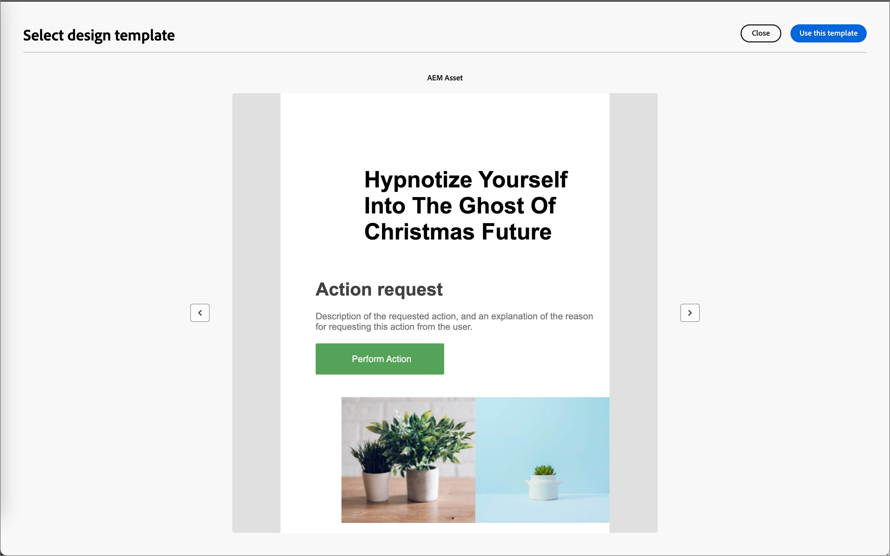{width="800" zoomable="yes"}

Quando l&#39;anteprima corrisponde a quella che desideri utilizzare, fai clic su **[!UICONTROL Usa questo modello]** in alto a destra nella finestra di anteprima.

Questa azione copia il contenuto nello spazio di progettazione dell’e-mail visiva, dove puoi modificarlo in base alle esigenze.

>[!TAB Modelli di esempio]

[!DNL Adobe Marketo Optimizer] fornisce una selezione di modelli incorporati che è possibile utilizzare per creare e-mail e modelli di posta elettronica.

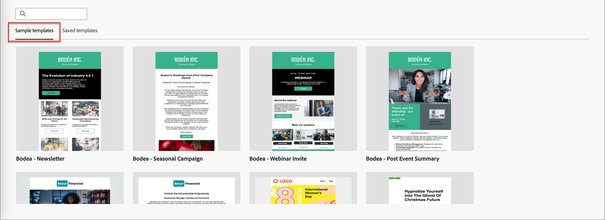{width="800" zoomable="yes"}

>[!ENDTABS]

## Aggiungere struttura e contenuto {#structure-content}

Utilizza l’editor e-mail visivo per creare il tuo messaggio e-mail. Aggiungi un preintestazione, struttura il layout con colonne e divisori, quindi popola tali strutture con componenti di contenuto come immagini, pulsanti e testo. Puoi anche applicare CSS personalizzati per lo stile avanzato e visualizzare in anteprima il rendering del design in modalità scura.

### Definire le impostazioni del corpo {#body-settings}

Le impostazioni del corpo definiscono il preheader, il titolo del documento e la lingua del documento per l’e-mail. Configura questi metadati nell’area di progettazione e-mail, separatamente dalla riga dell’oggetto dell’e-mail.

1. Seleziona **[!UICONTROL Corpo]** nella struttura di navigazione a sinistra, quindi seleziona la scheda **[!UICONTROL Impostazioni]** nel pannello a destra.

   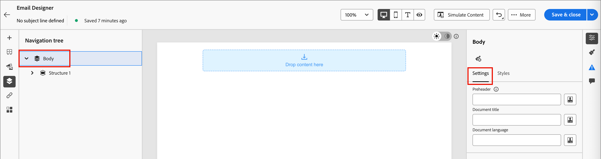{width="800" zoomable="yes"}

1. Completa i campi seguenti:

   * **[!UICONTROL Preheader]** - Immetti lo snippet di testo che viene visualizzato dopo la riga dell&#39;oggetto nelle anteprime della casella in entrata.

     >[!TIP]
     >
     >Mantieni il preheader tra 40 e 100 caratteri. Deve essere complementare all’oggetto (non ripetuto) e fornire al destinatario un motivo in più per aprire l’e-mail.

   * **[!UICONTROL Titolo documento]** - Immettere un titolo per il documento HTML dell&#39;e-mail. Questo è separato dalla riga dell’oggetto dell’e-mail.

   * **[!UICONTROL Lingua del documento]** - Specificare la lingua del documento di posta elettronica.

   Puoi fare clic sull&#39;icona _Aggiungi personalizzazione_ (  ) accanto a un campo per inserire [token di personalizzazione](#personalize-content).

### Modalità scura {#dark-mode}

Il rendering in modalità scura è supportato tramite le query multimediali CSS `prefers-color-scheme`. Gli strumenti di progettazione delle e-mail includono un’anteprima in modalità scura e opzioni per definire uno stile personalizzato per i client e-mail di supporto, che consente di verificare che il testo rimanga leggibile, che i loghi siano visibili e che i colori del brand resistano su sfondi scuri.

Per istruzioni dettagliate sull&#39;anteprima, sulla configurazione delle impostazioni della modalità scura personalizzata, sul supporto client e-mail e sulle best practice per i test, consulta [Modalità scura per il contenuto delle e-mail](./email-dark-mode.md).

### Aggiungere componenti struttura e contenuto {#components}

Crea il layout e-mail aggiungendo [componenti struttura](./structure-components.md) e [componenti contenuto](./content-components.md) all&#39;area di lavoro.

Trascina gli elementi dalle sezioni **[!UICONTROL Strutture]** e **[!UICONTROL Contenuti]** nel pannello a sinistra, quindi configura ogni componente nelle schede _[!UICONTROL Impostazioni]_ e _[!UICONTROL Stili]_ a destra.

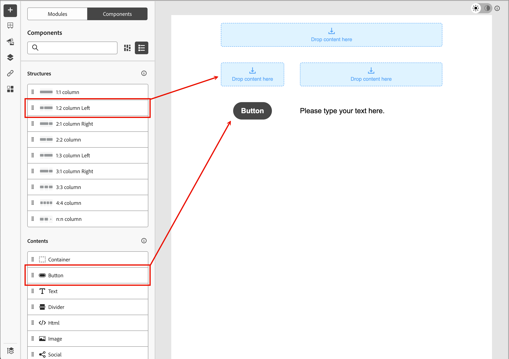{width="700" zoomable="yes"}

### Aggiungere CSS personalizzato {#custom-css}

Puoi aggiungere CSS personalizzato direttamente nello spazio di progettazione delle e-mail per uno stile avanzato oltre le impostazioni standard dei componenti. È consigliabile aggiungere questo stile di livello più alto prima di includere componenti di contenuto quali immagini, pulsanti e testo.

Consulta [Aggiungi CSS personalizzato per il contenuto](./design-custom-css.md) per i passaggi, le regole di sintassi e la risoluzione dei problemi.

>[!NOTE]
>
>Se il messaggio di posta elettronica è progettato utilizzando un modello [ con contenuto bloccato](./template-content-governance.md), non è possibile aggiungere CSS personalizzati al contenuto. L&#39;etichetta del pulsante diventa **[!UICONTROL Visualizza CSS personalizzato]** ed eventuali CSS personalizzati già presenti nel contenuto sono di sola lettura.

### Aggiungi frammenti {#visual-fragments}

Un frammento visivo è un componente di progettazione riutilizzabile a cui possono fare riferimento più risorse di contenuto in [!DNL Marketo Optimizer]. In genere si tratta di un blocco di contenuti che può essere precreato e inserito rapidamente per rendere l’authoring più rapido e coerente.

L’esempio seguente illustra i passaggi per aggiungere frammenti durante l’authoring dei contenuti.

1. Per aprire l&#39;elenco dei frammenti, seleziona l&#39;icona _Frammenti_ (  ).

   Puoi eseguire le seguenti operazioni:

   * Ordina l’inserzione.
   * Sfoglia, cerca o filtra l’inserzione.
   * Passa dalla visualizzazione delle miniature a quella dell’elenco e viceversa.
   * Aggiorna l’elenco per riflettere eventuali frammenti creati di recente.

   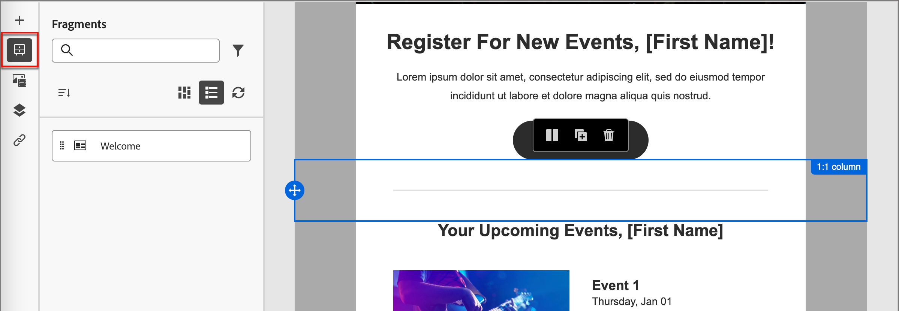{width="700" zoomable="yes"}

1. Trascina uno dei frammenti nel componente strutturale.

   L’editor esegue il rendering del frammento all’interno della sezione/elemento della struttura e-mail.

   Il contenuto del frammento viene aggiornato dinamicamente all’interno della struttura per visualizzare in anteprima il modo in cui viene eseguito il rendering del frammento nell’e-mail.

<!-- 
>[!BEGINSHADEBOX]

**Editable fields in customizable fragments**

A visual fragment can include editable fields that you can customize. Custom fields allow you to modify parameters when you incorporate the fragment into your content and create a tailored experience without affecting the original fragment. The fragment author can design the fragment for customization of text, image, and button components. If an included fragment contains components with editable fields, you can change the default values to customize it for your content.

1. Select the fragment component.

   The Settings displayed on the right include editable fields with the default values.

   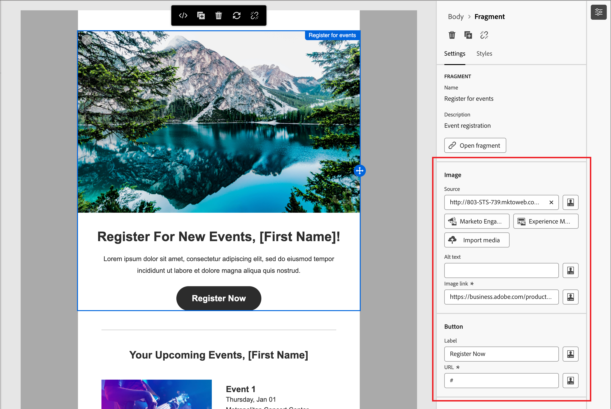{width="700" zoomable="yes"}   

1. Change any editable field as needed.

>[!ENDSHADEBOX]
-->

Dopo il salvataggio, l&#39;e-mail viene visualizzata nella pagina dei dettagli del frammento quando si seleziona la scheda _[!UICONTROL Usato da]_ nel riepilogo.

### Aggiungere risorse immagine {#insert-image}

Quando viene eseguito il provisioning di [!DNL Marketo Optimizer], le risorse Marketo Design Studio esistenti sono disponibili nello spazio di progettazione e-mail. Puoi sfogliare e inserire queste immagini nelle e-mail direttamente dal selettore delle risorse.

>[!IMPORTANT]
>
>La disponibilità delle risorse in [!DNL Marketo Optimizer] si basa su una **copia occasionale** delle risorse da Marketo Design Studio. La modifica delle risorse in Marketo Engage dopo la copia iniziale è **not** riflessa in [!DNL Marketo Optimizer]. È inoltre possibile caricare le risorse immagine direttamente dallo spazio di progettazione visiva o dalla [libreria Assets](./digital-asset-management.md).

Tipi di file immagine supportati:

* **Completamente supportato** (visibile nel selettore, incorporabile in linea): JPG, PNG, GIF, WebP.
* **Accessibile con attenzione**: SVG (con un avviso che alcuni client di posta elettronica non eseguono il rendering di SVG).
* **Non supportato in questa versione di Beta:** TIFF, PDF, DOCX, XLSX, PPTX, CSS, JS, HTML, TXT, file binari, PSD, AI, INDD.

Nello spazio di progettazione del contenuto visivo, seleziona l&#39;icona _Assets_ (  ) nella barra di navigazione a sinistra. Dal selettore delle risorse, puoi selezionare direttamente le risorse memorizzate nella libreria Assets.

* Aggiungi una nuova risorsa trascinando la risorsa immagine in un componente struttura.

  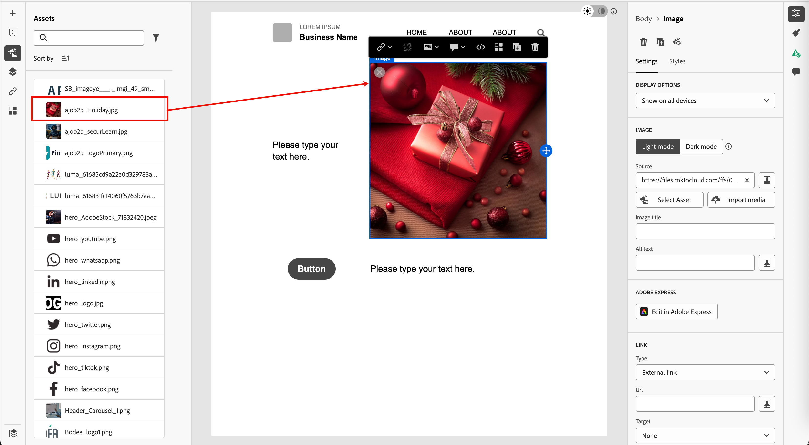{width="800" zoomable="yes"}

* Sostituisci una risorsa immagine esistente selezionandola nell&#39;area di lavoro e facendo clic su **[!UICONTROL Seleziona risorsa]** negli strumenti origine immagine.

  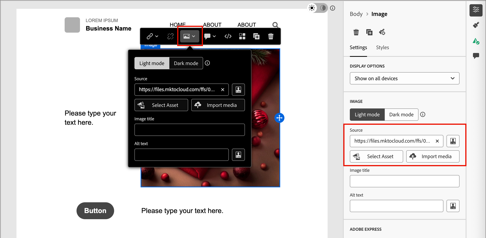{width="600" zoomable="yes"}

Per ulteriori informazioni sull&#39;utilizzo delle risorse, vedere [_Utilizzare le risorse per la creazione dei contenuti_](./digital-asset-management.md#assets-authoring).

### Spostarsi tra livelli, impostazioni e stili {#navigation-layers}

Utilizza la struttura di navigazione per selezionare componenti e colonne, quindi regolane impostazioni e stili nel pannello di destra. Vedi [Struttura di navigazione](./structure-components.md#navigation-tree).

### Personalizzazione dei contenuti {#personalize-content}

[!DNL Marketo Optimizer] utilizza la sintassi Handlebars per la personalizzazione. I token vengono sostituiti al momento dell’invio con i valori dei dati di profilo di ciascun destinatario. In diverse posizioni è possibile utilizzare la personalizzazione in un’e-mail:

* **Oggetto**: punto di personalizzazione più comune.
* **Metadati corpo** — impostati nell&#39;area di lavoro visiva; supporta i token di attributi del profilo.
* **Testo del corpo dell&#39;e-mail**: nomi e altri attributi di profilo inseriti in linea.
* **URL pulsante** — aggiungi parametri per destinatario.

>[!NOTE]
>
>In questa versione di Beta, nell’editor di Personalization sono disponibili solo gli attributi del profilo.

_Per aggiungere la personalizzazione :_

1. Nell’area di progettazione e-mail (o nella pagina delle proprietà e-mail per la riga dell’oggetto), fai clic sul campo in cui desideri inserire un token.
1. Fai clic sull&#39;icona _Personalizza_ (  ) per utilizzare un token di personalizzazione.
1. Nella finestra di dialogo di personalizzazione, sfoglia la struttura dello schema a sinistra. Sono elencati gli attributi del profilo (nome, cognome, e-mail, titolo del processo e altri campi del profilo).
1. Seleziona un attributo. L&#39;editor inserisce l&#39;espressione Handlebars corrispondente, ad esempio `{{profile.firstName}}`.
1. Aggiungere un valore di fallback per gestire i dati mancanti: `{{profile.firstName | default: "there"}}`.
1. Fai clic su **[!UICONTROL Conferma]** o **[!UICONTROL Inserisci]**. L’espressione viene visualizzata in linea nel campo.

+++Pattern di personalizzazione comuni {#personalization-patterns}

Utilizza espressioni Handlebars come le seguenti (la personalizzazione utilizza la stessa sintassi descritta in [Personalizza contenuto](#personalize-content)):

* `{{profile.lastName}}` - Inserire il cognome del destinatario.
* `{{profile.jobTitle}}` — Fare riferimento al titolo del processo del destinatario nella copia del corpo.
* `{{profile.firstName}}, ready to take the next step?` - Combina token e testo statico in linea.

Per un saluto di nome con un fallback quando manca il valore, utilizza l&#39;helper `default` come mostrato nei passaggi di personalizzazione precedenti (ad esempio, nome con `"there"` predefinito).

+++

+++Helper Handlebars {#handlebars-helpers}

Oltre a `default`, l&#39;editor di personalizzazione include helper Handlebars incorporati per logica condizionale, trasformazione del testo e formattazione della data. Utilizza il browser delle funzioni dell’editor per esplorare gli helper disponibili e inserirli con la sintassi corretta.

>[!TIP]
>
>Nello spazio di progettazione delle e-mail, digita `{{` direttamente in qualsiasi campo di testo per attivare un elenco a discesa di completamento automatico in linea contenente gli attributi di profilo disponibili. Non è necessario aprire la finestra di dialogo di personalizzazione completa per gli inserimenti rapidi.

+++

+++Espressioni assistite da IA {#ai-personalization}

[!DNL Coworker] nell&#39;editor di personalizzazione può generare espressioni Handlebars da una descrizione in linguaggio semplice, spiegare cosa fa un&#39;espressione esistente e identificare potenziali problemi. Utilizzala per accelerare l’authoring delle espressioni, in particolare per gli helper per la logica condizionale o la formattazione della data.

+++

Per informazioni dettagliate sugli strumenti e sulla sintassi dell&#39;editor di espressioni, vedere [Espressioni Personalization](./personalization-expressions.md).

### Modifica tracciamento URL collegato {#preview-and-edit-linked-urls}

{{$include /help/_includes/content-design-links.md}}

## Controllare e testare l’e-mail {#check-and-test-the-email}

Utilizza i controlli per l’anteprima desktop e mobile nella barra degli strumenti e-mail design space per rivedere il layout dell’e-mail prima di salvarla. Passa all&#39;anteprima in modalità scura per verificare la leggibilità e il contrasto (vedi [Modalità scura per contenuti e-mail](./email-dark-mode.md)).

I profili di test, [!UICONTROL Simula contenuto] e invia flussi di lavoro di bozza non sono disponibili in questa versione di Beta. Consulta [Limitazioni correnti](../marketing/email-channel.md#limitations) nella panoramica del canale e-mail.

Rivedi [Convalida del contenuto delle e-mail](#validation) per gli avvisi sul contenuto da risolvere prima dell&#39;attivazione del percorso.

## Convalida del contenuto delle e-mail {#validation}

Prima di poter attivare il percorso, il contenuto dell’e-mail deve essere valido. [!DNL Marketo Optimizer] genera avvisi a livello di contenuto nel messaggio e-mail e nell&#39;area di lavoro del percorso. Questa sezione descrive gli avvisi che potresti visualizzare e come risolverli.

### Avvisi di contenuto comuni {#content-alerts}

| Avviso | Che cosa significa | Come risolvere |
| ----- | ------------- | -------------- |
| **Riga oggetto mancante** | Il campo Oggetto è vuoto. | Apri l&#39;e-mail e immetti un oggetto nella scheda **[!UICONTROL Contenuto]**. I token Personalization sono consentiti, ma il campo non può essere vuoto. |
| **Il corpo dell&#39;email è vuoto** | L’area di lavoro nell’area di progettazione e-mail non ha contenuto. | Fai clic su **[!UICONTROL Modifica corpo dell&#39;e-mail]** per aprire lo spazio di progettazione e-mail. Trascina nell’area di lavoro almeno un componente Struttura e uno Contenuto, quindi fai clic su Salva. |
| **Configurazione canale non selezionata** | Non è stata scelta alcuna configurazione del canale e-mail per il nodo e-mail. | Nella scheda **[!UICONTROL Azioni]**, seleziona una **[!UICONTROL configurazione canale e-mail]** attiva. |
| **Configurazione canale eliminata** | La configurazione di canale selezionata in precedenza è stata eliminata o non è più attiva. | Nella scheda **[!UICONTROL Azioni]**, seleziona un&#39;altra **[!UICONTROL configurazione canale e-mail attiva]**. Se non ne è disponibile alcuna, un amministratore deve crearne o riattivarne una in [Configurazione canale e-mail](../admin/email-channel-configuration.md). |
| **La dimensione dell&#39;e-mail supera i 100 KB** | La dimensione totale dell’e-mail (HTML, CSS in linea, contenuto codificato) supera il limite di 100 KB previsto per le best practice ISP. | Riduci la dimensione dell’e-mail: sostituisci immagini in linea di grandi dimensioni con immagini ospitate esternamente da Marketo Design Studio, rimuovi i file CSS in linea non utilizzati, semplifica le strutture nidificate. |
| **Token di personalizzazione non risolto** | Un token Handlebars fa riferimento a un attributo di profilo senza fallback e l’attributo potrebbe non essere presente per alcuni destinatari. | Aggiungere un fallback utilizzando l&#39;helper Handlebars `default` come descritto in [Personalizzare il contenuto](#personalize-content). In alternativa, limita il pubblico di percorso ai profili in cui l’attributo è garantito. |
| **Immagine non caricata** | Un componente immagine fa riferimento a una risorsa che non è più disponibile. | Fai clic sull’immagine, apri il selettore risorse e riseleziona la risorsa dalla libreria di Assets. |
