# Creare e-mail e aggiungerle ai percorsi

[!DNL Adobe Marketo Optimizer] offre agli esperti di marketing B2B un&#39;esperienza moderna di authoring e consegna di e-mail di livello enterprise, per consentirti di creare, pubblicare e inviare e-mail dai tuoi programmi e percorsi.

Le e-mail sono risorse autonome, quindi non è necessario un percorso per crearne una. [Crea un&#39;e-mail](#create-email-from-programs) in un programma o in una delle sue cartelle, [pubblicala](#publish-email) quando è pronta, quindi [inviala da qualsiasi percorso di tale programma](#add-email-from-journey).

## Ciclo di vita e-mail {#lifecycle}

Un’e-mail è sempre in uno dei seguenti stati:

| Stato | Descrizione |
| ----- | ----------- |
| **Bozza** | Ogni nuova e-mail inizia come una bozza, che viene visualizzata con un’icona di busta rossa nella struttura dei programmi. Puoi modificarne le proprietà, le azioni e il contenuto e personalizzarlo, analizzarlo, rinominarlo o eliminarlo. |
| **Pubblicato** | Un’e-mail pubblicata è bloccata e pronta per l’invio e viene visualizzata con l’icona della busta verde. Non può essere modificato o annullato e viene elencato quando scegli un’e-mail in un percorso. |
| **In un percorso** | Quando selezioni un&#39;e-mail pubblicata in un&#39;azione _Invia e-mail_, viene creata una copia pubblicata che appartiene al percorso. La copia è di sola lettura e non cambia se l’originale viene successivamente duplicato e rivisto. |

Un messaggio e-mail viene spostato dalla bozza alla pubblicazione al momento della pubblicazione. Se selezionata per un nodo azione _Invia e-mail_, una copia risiede nel percorso. Per modificare un&#39;e-mail pubblicata, [duplicala](#duplicate-email). Il duplicato viene creato come bozza con lo stesso contenuto e le stesse impostazioni.

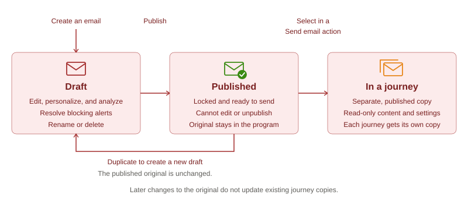{width="800" zoomable="yes"}

Lo stato dell’e-mail determina la disponibilità dell’azione:

| Azione | Bozza | Pubblicato | In un percorso |
| ------ | ----- | --------- | ------------ |
| Modificare proprietà, azioni e contenuto | Sì | No | No |
| Personalizzazione e-mail | Sì | No | No |
| Analizza e-mail | Sì | No | No |
| Pubblica | Sì, una volta risolti gli avvisi di blocco | Già pubblicato | Pubblicato automaticamente |
| Duplica | Sì | Sì | No |
| Rinomina | Sì | No | No. La copia viene denominata quando la si seleziona. |
| Elimina | Sì | No | No. Elimina il nodo _Invia e-mail_. |
| Seleziona in un percorso | No | Sì | Non applicabile |

## Prerequisiti {#before-you-begin}

Assicurati che il tuo ruolo utente includa le [autorizzazioni prodotto](../start/permissions-reference.md) seguenti per le attività che esegui:

* **[!UICONTROL Visualizza programmi B2B]** e **[!UICONTROL Visualizza cartelle B2B]** - Visualizza i programmi e le cartelle in cui risiedono le e-mail.
* **[!UICONTROL Visualizza e-mail B2B]** - Visualizza messaggi e-mail.
* **[!UICONTROL Gestione e-mail B2B]**: crea, modifica, duplica, rinomina, elimina e pubblica e-mail.
* **[!UICONTROL Gestisci Percorsi di persone B2B]** - Aggiungi o sostituisci azioni e-mail in un percorso di persone. Per l&#39;accesso in sola lettura ai percorsi, utilizzare **[!UICONTROL Visualizza Percorsi di persone B2B]**.
* **[!UICONTROL Gestisci esperienza conversazionale B2B]** - Accedi a [!DNL Coworker] per personalizzare o analizzare un&#39;e-mail. Le azioni in [!DNL Coworker] richiedono anche le autorizzazioni e-mail corrispondenti.

Autorizzazioni aggiuntive sono necessarie solo se si eseguono le seguenti operazioni di impostazione o invio correlate:

* **[!UICONTROL Gestisci programmi B2B]** - Crea un programma se non ne esiste già uno.
* **[!UICONTROL Gestione configurazioni canali B2B]** e **[!UICONTROL Visualizza impostazioni e-mail B2B]** - Crea una configurazione del canale e-mail. Gli amministratori devono inoltre **[!UICONTROL Gestire le impostazioni delle e-mail B2B]** per configurare le impostazioni di consegna delle e-mail.
* **[!UICONTROL Pubblica Percorsi di persone B2B]** - Pubblica il percorso che invia l&#39;e-mail.

Prima di creare un’e-mail, conferma quanto segue:

* Le e-mail risiedono in un programma o in una delle sue cartelle. Definisci il programma prima di creare un’e-mail. Un percorso può inviare e-mail solo dal proprio programma.
* Per selezionare una configurazione del canale e-mail, utilizza la scheda **[!UICONTROL Azioni]**. Gli amministratori gestiscono [la configurazione del canale e-mail](../admin/email-channel-configuration.md).
* Puoi creare tutte le e-mail necessarie all’interno di un programma.

>[!NOTE]
>
>Se invii un&#39;e-mail per la prima volta, assicurati che [recapito e-mail](../start/email-deliverability.md) e il [canale e-mail](../admin/email-channel-configuration.md) necessari siano configurati.

<!-- 
* **Email channel configurations** - Manage the sender identity, reply behavior, marketing vs. transactional message types, and tracking.
* **Email deliverability controls** - Set up your email deliverability channel, including subdomain delegation (Fully Delegated and CNAME methods), DMARC, SPF/DKIM auto-configuration, and shared IP pool support.
* **Send Email action** - From a journey, add a _Send email_ action node, including personalization using profile attributes (Handlebars syntax).
* **Visual drag-and-drop email design tools** -  Design your email content with structures, content components, themes, dark-mode support, and reusable visual fragments.
* **Marketo Design Studio assets** — Choose images and assets from a one-time copy of your Marketo Engage asset library directly inside the email canvas.
* **Reusable templates and fragments** — Save common headers, footers, CTAs, and full email layouts and reuse them across journeys.
* **Role-Based Access Control (RBAC)** — Apply granular permissions for creating, editing, approving, and sending email. 
-->

>[!BEGINSHADEBOX]

## Limitazioni attuali {#limitations}

* **I profili di test, Simula contenuto e Invia bozza** non sono disponibili nella versione corrente. Il rendering di Litmus e i rapporti di posta indesiderata basati su SpamAssassin sono pianificati per una versione futura.
* **I dati relativi alla personalizzazione a livello di account e agli oggetti personalizzati** non sono disponibili nella versione corrente. Utilizza gli attributi del profilo.
* **Migrazione automatizzata Velocity-to-Handlebars** dei modelli [!DNL Marketo Engage] esistenti è disponibile su richiesta.
* **Commenti e-mail e collaborazione** (commenti in linea, @mentions, flusso di lavoro di richiesta-revisione) sono pianificati per una versione futura.
* **Le integrazioni di AEM Assets, Frammenti di contenuto AEM e Adobe Express** sono pianificate per una versione futura.

>[!ENDSHADEBOX]

## Concetti chiave {#key-concepts}

Prima di creare e-mail per percorsi di persone e contenuti e-mail, esamina i seguenti concetti:

| Concetto | In [!DNL Adobe Marketo Optimizer] |
| ------- | ---------------------- |
| **_[Spazio di progettazione e-mail](../content/email-authoring.md#email-design-tools)_** | L’area di lavoro visiva e gli strumenti di progettazione utilizzati per comporre il contenuto delle e-mail. Include componenti di layout drag-and-drop, modelli, frammenti, temi e un editor di personalizzazione. |
| **_[Modello](../content/templates.md)_** | Layout e-mail riutilizzabile disponibile per la creazione di un nuovo messaggio e-mail. Può essere un modello di esempio integrato fornito da Adobe o un modello personalizzato creato dal team. |
| **_[Frammento visivo](../content/fragments.md)_** | Blocco di contenuto riutilizzabile (ad esempio intestazione, piè di pagina, CTA, dichiarazione di non responsabilità legale) che può essere inserito in più e-mail. L’aggiornamento di un frammento propaga la modifica a ogni e-mail che lo utilizza. |
| **_[Tema](../content/email-authoring.md#design-from-scratch)_** | Predefinito di stile riutilizzabile (colori, composizione tipografica, spaziatura, stili di pulsante) applicato a un messaggio e-mail. |
| **_[Token Personalization](../content/personalization-expressions.md)_** | Un&#39;espressione Handlebars, ad esempio `{{profile.firstName}}`, è stata risolta in fase di invio utilizzando i dati del profilo di ogni destinatario. |
| **_[E-mail autonoma](#lifecycle)_** | Una risorsa e-mail che esiste indipendentemente da qualsiasi percorso. Viene creato in un programma o in una delle sue cartelle e si sposta dalla bozza alla pubblicazione. |
| **_[Tipo di e-mail](#email-types)_** | La classificazione scelta al momento della creazione di un&#39;e-mail, **[!UICONTROL Marketing]** o **[!UICONTROL Transazionale]**. Indica a [!DNL Marketo Optimizer] come trattare il messaggio ai fini del consenso. |
| **_[Invia azione e-mail](./action-nodes.md#add-an-action-node)_** | Nodo di azione del percorso che utilizza una configurazione di canale e contenuti e-mail per inviare un messaggio e-mail. |

## Tipi di e-mail {#email-types}

Quando crei un’e-mail, ne scegli il tipo. Il tipo indica a [!DNL Marketo Optimizer] come trattare il messaggio ai fini del consenso, quindi scegli quello che corrisponde al motivo per cui lo stai inviando.

| Tipo | Usa per |
| ---- | ------- |
| **[!UICONTROL Marketing]** | Messaggi promozionali, ad esempio un annuncio di lancio di un prodotto, una newsletter o un invito ad un evento. |
| **[!UICONTROL Transazionale]** | Messaggi operativi che una persona si aspetta a causa di qualcosa che ha fatto, come un ordine, una registrazione o una conferma di spedizione. |

Il tipo viene visualizzato come indirizzo e-mail **[!UICONTROL Categoria]** nella scheda **[!UICONTROL Proprietà]**.

## Creare un messaggio e-mail nella struttura dei programmi {#create-email-from-programs}

Crea un messaggio e-mail in un programma o in una cartella per generarlo indipendentemente da qualsiasi percorso.

1. Nella barra di navigazione a sinistra, espandere **[!UICONTROL Gestione marketing]** e selezionare **[!UICONTROL Programmi]**.

1. Nella struttura dei programmi fare clic sull&#39;icona _Altro_ (**...**) accanto al programma o alla cartella in cui si desidera creare l&#39;e-mail e selezionare **[!UICONTROL Crea e-mail]**.

   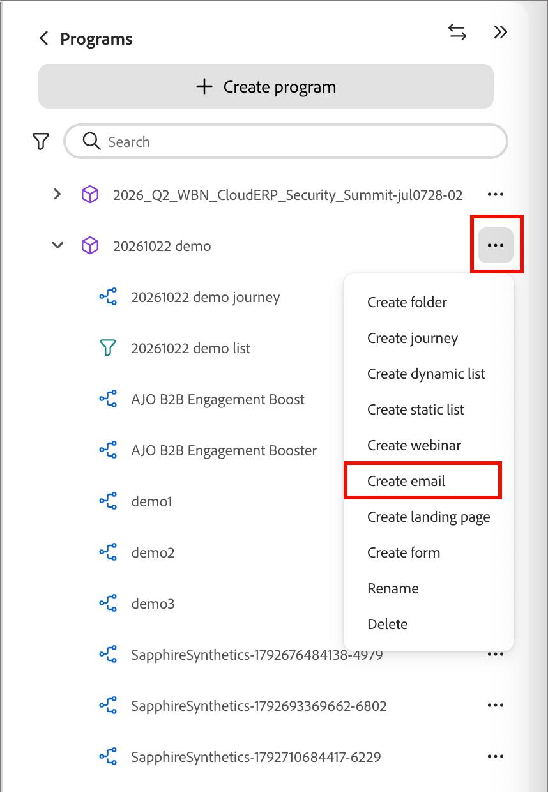{width="400"}

1. Nella finestra di dialogo _[!UICONTROL Crea e-mail]_, completa i campi seguenti:

   * **[!UICONTROL Elemento padre]** - (obbligatorio) il programma o la cartella in cui viene salvato il messaggio e-mail. È impostato sul programma di origine e può essere modificato in un altro programma o in una delle cartelle del programma.

   * **[!UICONTROL Tipo di e-mail]** - Seleziona **[!UICONTROL Marketing]** o **[!UICONTROL Transazionale]** (vedi [Tipi di e-mail](#email-types)).

   * **[!UICONTROL Nome]** - (Obbligatorio) Immettere un nome che identifichi l&#39;e-mail nella struttura dei programmi.

   * **[!UICONTROL Descrizione]** - (Facoltativo) Inserisci una nota per il tuo team sull&#39;e-mail e il suo scopo.

   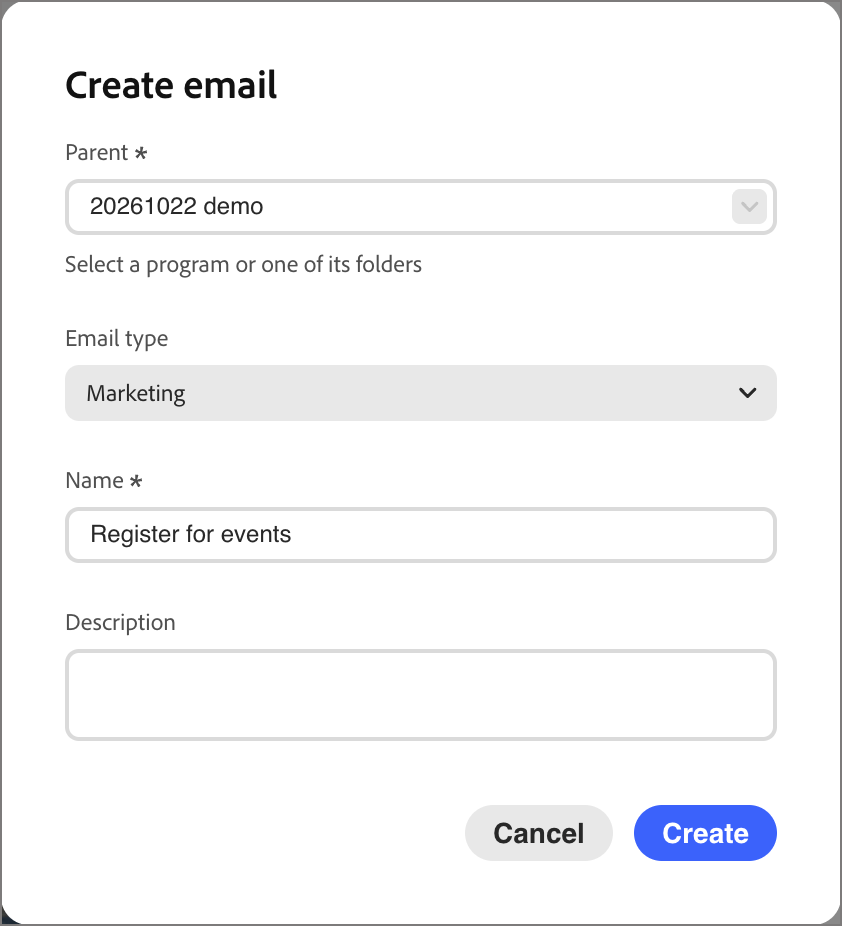{width="400"}

1. Fai clic su **[!UICONTROL Crea]**.

L’e-mail si apre nella propria scheda e viene visualizzata sotto il programma nella struttura dei programmi come bozza. Quando un&#39;e-mail è aperta, qualsiasi richiesta di [!DNL Coworker] viene indirizzata a tale e-mail.

Quindi, [configura l&#39;e-mail](#define-email-properties), [risolvi eventuali avvisi](#alerts) e [pubblicala](#publish-email).

### Definire le proprietà e le azioni dell’e-mail {#define-email-properties}

Una bozza di messaggio e-mail ha tre schede: **[!UICONTROL Proprietà]**, **[!UICONTROL Azioni]** e **[!UICONTROL Contenuto]**. Elaborale in ordine, quindi salva le modifiche. La pagina e-mail viene visualizzata quando si crea un messaggio e-mail nella struttura dei programmi. Per aprire una bozza in un secondo momento, seleziona l’e-mail nella struttura dei programmi.

#### Completare le schede Proprietà e Azioni {#properties-actions-tabs}

1. (Facoltativo) Nella scheda **[!UICONTROL Proprietà]**, immetti una **[!UICONTROL Descrizione]** e qualsiasi altra informazione descrittiva che desideri acquisire per l&#39;e-mail.

   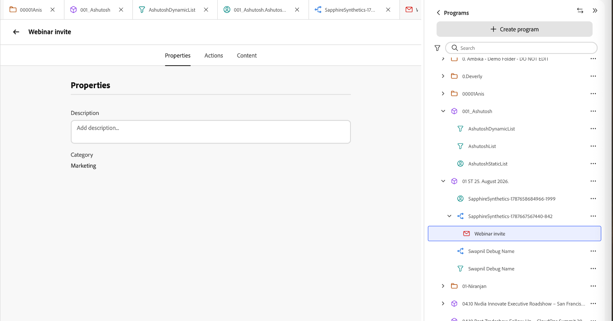{width="800" zoomable="yes"}

1. Seleziona la scheda **[!UICONTROL Azioni]** e completa le impostazioni funzionali per l&#39;e-mail:

   * **[!UICONTROL E-mail]** - Seleziona o crea una **[!UICONTROL Configurazione del canale e-mail]** da utilizzare.

     Si tratta del set riutilizzabile di impostazioni di consegna e-mail che definisce l’identità del mittente, l’indirizzo di risposta, il sottodominio, il pool IP, il tipo di e-mail (marketing o transazionale) e il tracciamento. Fai clic sull&#39;icona _Visualizza_ per esaminare le impostazioni per la configurazione selezionata.

     Gli amministratori creano configurazioni in [Configurazione del canale e-mail](../admin/email-channel-configuration.md).

   * **[!UICONTROL Regole aziendali]** - (Facoltativo) Applica regole di limitazione o di inattività all&#39;azione e-mail selezionando un set di regole.

     Per ulteriori informazioni sulle regole business e su come definire e attivare set di regole per le comunicazioni di canale, vedere [_Regole business_](../admin/business-rules.md).

   * **[!UICONTROL Tracciamento azioni]** - Selezionare le caselle di controllo per le azioni di cui si desidera tenere traccia per l&#39;e-mail.

   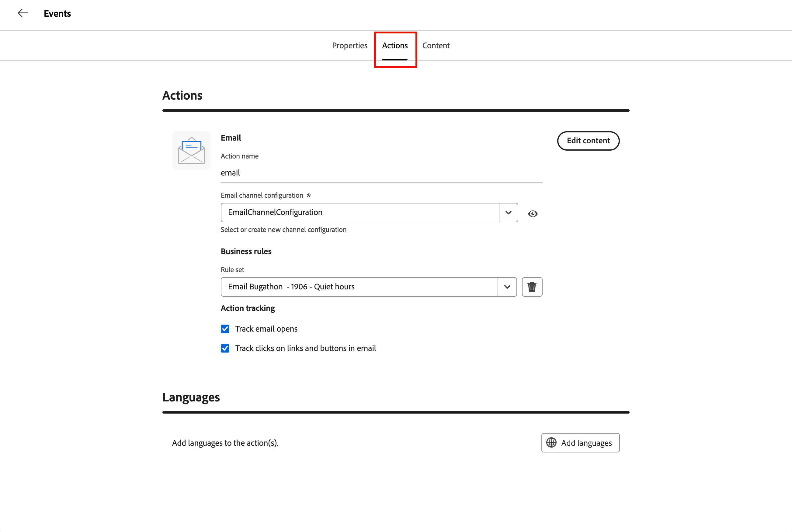{width="600" zoomable="yes"}

#### Aggiungere l’oggetto e il contenuto {#content-tab}

1. Fare clic su **[!UICONTROL Modifica contenuto]** oppure selezionare la scheda **[!UICONTROL Contenuto]**.

   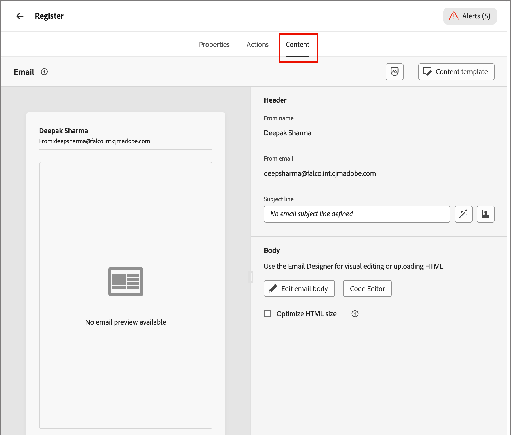{width="500" zoomable="yes"}

1. Immettere il testo **[!UICONTROL Oggetto]** che si desidera visualizzare nel campo oggetto dell&#39;e-mail.

   L&#39;oggetto è obbligatorio.

   Fai clic sull&#39;icona _Personalizza_ (  ) per utilizzare un token di personalizzazione nel campo.

1. (Facoltativo) Selezionare la casella di controllo **[!UICONTROL Ottimizza dimensioni HTML]** per ridurre le dimensioni del HTML di posta elettronica durante il processo di pubblicazione.

   Questo aiuta a prevenire il clipping delle e-mail in client come Gmail. Gmail tronca i messaggi superiori a 100 KB. Per ulteriori informazioni, vedere [_Ottimizzare le dimensioni del HTML e-mail_](#optimize-html-size).

1. Fai clic su **[!UICONTROL Modifica corpo dell&#39;e-mail]** per accedere agli strumenti di progettazione visiva e avviare [la creazione del contenuto](../content/email-authoring.md).

   In alternativa, puoi fare clic su **[!UICONTROL Editor di codice]** per scrivere il codice del tuo contenuto in HTML normale. Se disponi di HTML da riutilizzare per la progettazione delle e-mail, puoi copiarlo e incollarlo nell’editor.

### Controllare gli avvisi {#alerts}

Il pulsante **[!UICONTROL Avvisi]** nell&#39;intestazione e-mail mostra il numero di problemi trovati [!DNL Adobe Marketo Optimizer]. Fai clic su di esso per visualizzare l’elenco.

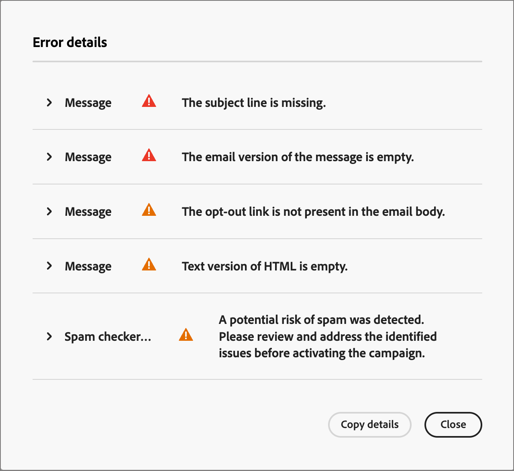{width="450"}

Gli avvisi sono disponibili in due tipi:

* **Problemi di blocco** - Anche se alcuni di questi problemi rimangono, **[!UICONTROL Pubblica]** non è disponibile e nel menu dell&#39;e-mail _Altro_ sono visualizzati **[!UICONTROL Risolvi avvisi e-mail per la pubblicazione]**. Risolvi tutti i problemi di blocco prima di pubblicare l’e-mail.

  Gli esempi includono:

  * Il nome del mittente è vuoto
  * Riga oggetto mancante
  * Il contenuto dell’e-mail è vuoto

* **Avvisi** - Questi segnalano aspetti che meritano di essere esaminati ma non impediscono la pubblicazione. Un messaggio e-mail può mostrare un avviso ed essere comunque pubblicato se gli avvisi rimanenti sono avvisi.

  Gli esempi includono:

  * Il collegamento di rinuncia non è presente nel corpo dell’e-mail
  * La versione testo di HTML è vuota
  * Sono stati rilevati collegamenti vuoti
  * L&#39;e-mail supera i 100 K

## Gestire le e-mail nella struttura dei programmi {#manage-emails}

Le e-mail vengono visualizzate nella struttura dei programmi con un’icona a forma di busta. Una busta rossa contrassegna uno sformo. Una busta verde contrassegna un’e-mail pubblicata. Fai clic sull&#39;icona _Altro_ (**...**) accanto a un messaggio e-mail per gestirlo.

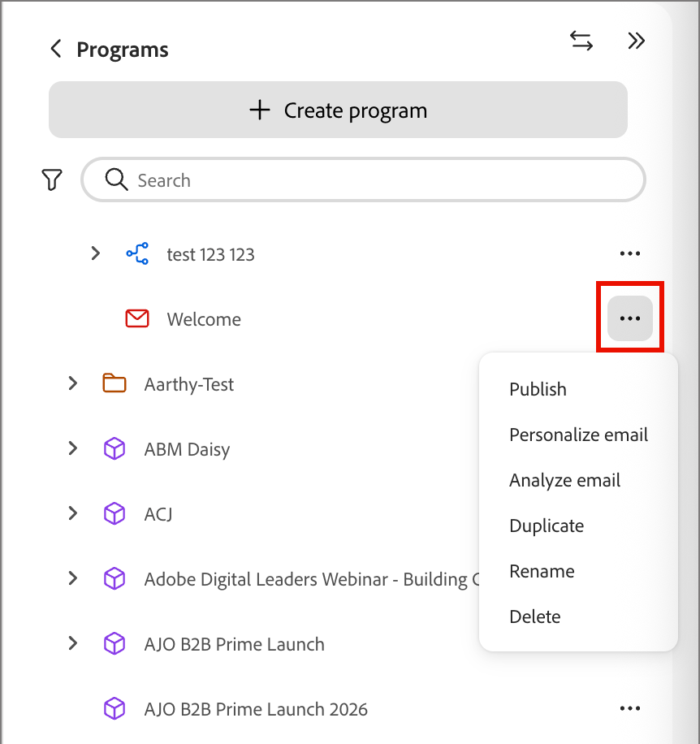{width="400"}

Il menu per una bozza di e-mail include **[!UICONTROL Pubblica]**, **[!UICONTROL Personalizza e-mail]**, **[!UICONTROL Analizza e-mail]**, **[!UICONTROL Duplica]**, **[!UICONTROL Rinomina]** e **[!UICONTROL Elimina]**.

Per un&#39;e-mail pubblicata, **[!UICONTROL Duplica]** è l&#39;unica opzione.

### Personalizzare e analizzare un’e-mail {#personalize-analyze}

Mentre un&#39;e-mail è una bozza, il relativo menu _Altro_ include due strumenti di contenuto. Eseguile prima della pubblicazione, perché non è possibile modificare un messaggio e-mail pubblicato.

* **[!UICONTROL Personalizza e-mail]** - Apre [!DNL Coworker] con l&#39;e-mail caricata. Per aggiungere contenuti personalizzati all’e-mail, descrivi il gruppo target. Per ulteriori informazioni, vedere [_Personalizzare il contenuto delle e-mail per persona_](../agents/personalize-content.md).

  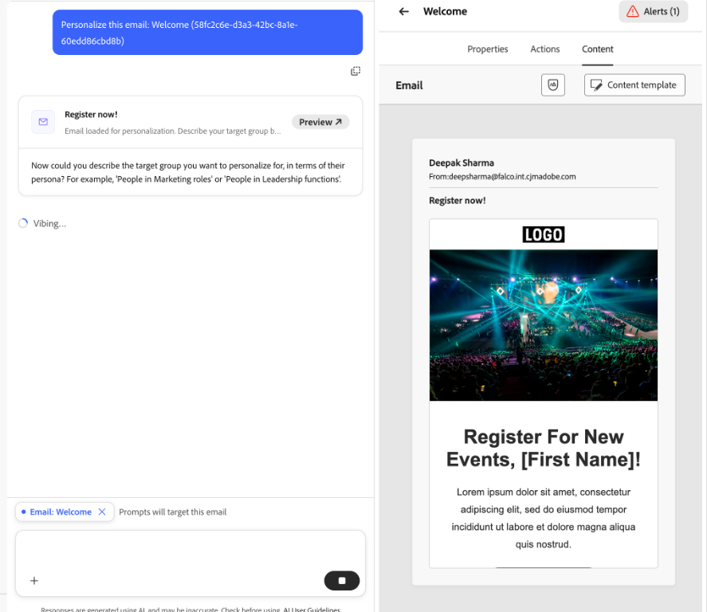{width="700" zoomable="yes"}

* **[!UICONTROL Analizza e-mail]** - Esamina il contenuto già creato. Vedi [Analizzare un&#39;e-mail esistente](../agents/personalize-content.md#analyze-existing-email).

### Pubblicare un’e-mail {#publish-email}

Pubblica un’e-mail quando è pronta per l’invio. Quando [selezioni un&#39;e-mail in un percorso](#add-email-from-journey) vengono elencati solo i messaggi e-mail pubblicati.

1. Assicurati che l&#39;e-mail non contenga [avvisi](#alerts) di blocco.

1. Nella struttura dei programmi fare clic sull&#39;icona _Altro_ (**...**) accanto all&#39;e-mail e seleziona **[!UICONTROL Pubblica]**.

1. Nella finestra di dialogo di conferma _[!UICONTROL Pubblica e-mail]_, fai clic su **[!UICONTROL Pubblica]**.

   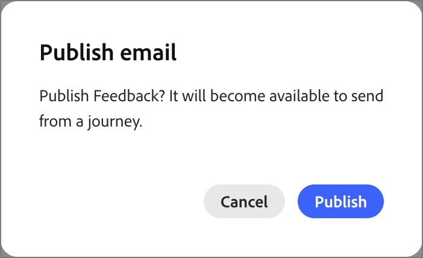{width="400"}

L’icona e-mail diventa verde. Se selezioni l’e-mail, questa si apre in una visualizzazione di sola lettura che ne riepiloga il contenuto, le proprietà e le azioni.

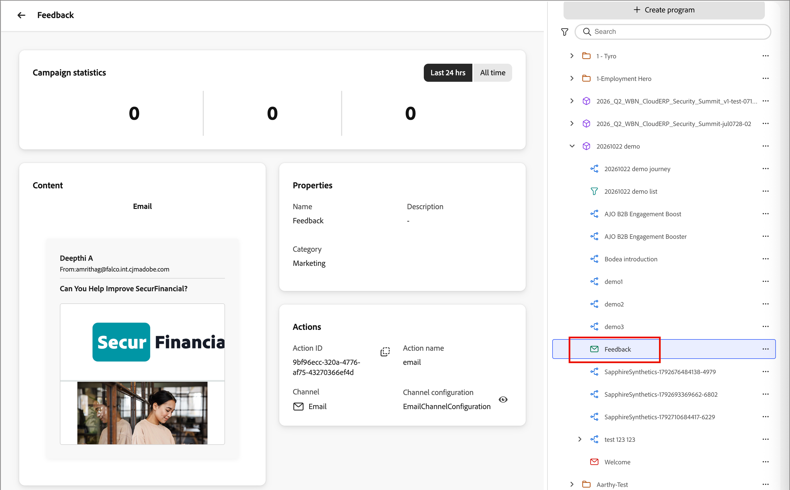{width="700" zoomable="yes"}

>[!IMPORTANT]
>
>La pubblicazione è permanente. Un messaggio e-mail pubblicato non può essere modificato, rinominato, eliminato o restituito come bozza. Per apportare modifiche, [duplicare l&#39;e-mail](#duplicate-email).

### Duplicare un’e-mail {#duplicate-email}

Per modificare un’e-mail pubblicata, duplicala. Per provare una variante senza modificare l&#39;originale, potete anche duplicare una bozza.

1. Nella struttura dei programmi fare clic sull&#39;icona _Altro_ (**...**) accanto all&#39;e-mail e seleziona **[!UICONTROL Duplica]**.

1. Nella finestra di dialogo _[!UICONTROL E-mail duplicata]_, se necessario, modifica il **[!UICONTROL Nome]**.

   Viene utilizzato il nome originale seguito da `_copy`. Se necessario, aggiungere una **[!UICONTROL Descrizione]**.

   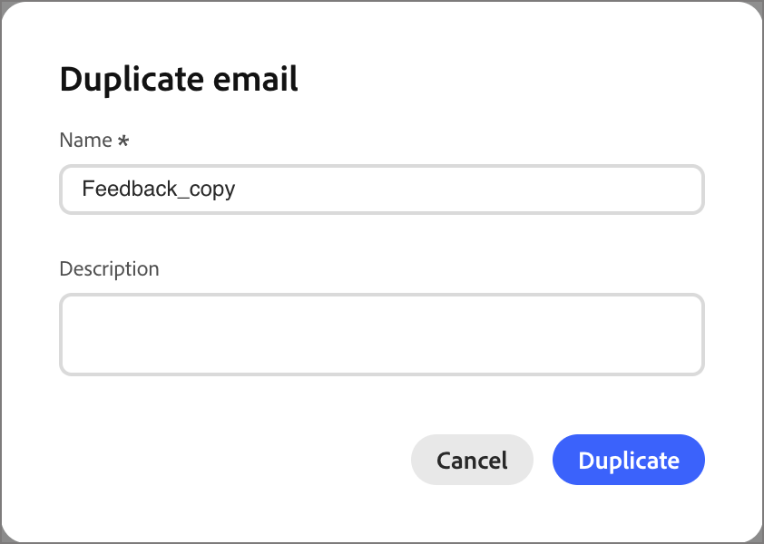{width="400"}

1. Fai clic su **[!UICONTROL Duplica]**.

Il duplicato viene creato come bozza con lo stesso contenuto e le stesse impostazioni. Apportare le modifiche e quindi pubblicarle.

## Aggiungere un messaggio e-mail a un percorso {#add-email-from-journey}

Per inviare un messaggio e-mail, aggiungilo a un percorso nello stesso programma. Quando selezioni un&#39;e-mail, [!DNL Marketo Optimizer] ne crea una copia per quel percorso e pubblica automaticamente la copia. Le e-mail provengono dalla struttura dei programmi, quindi [crea e pubblica prima l&#39;e-mail](#create-email-from-programs).

Puoi utilizzare la stessa e-mail in più percorsi. Ogni volta che la selezioni, viene creata una copia separata per quel percorso e puoi assegnare a ciascuna copia un nome univoco.

### Seleziona un messaggio e-mail per un’azione Invia messaggio e-mail {#select-email-in-journey}

1. Apri il percorso e seleziona o aggiungi un [_Azione_ nodo](action-nodes.md#add-an-action-node).

1. In _[!UICONTROL Seleziona azione]_, scegli **[!UICONTROL Invia e-mail]**.

1. In _[!UICONTROL Origine e-mail]_, scegliere una delle opzioni seguenti:

   * **[!UICONTROL Selezionare un&#39;e-mail dalla struttura del programma]**. Scegliere questa opzione per utilizzare un&#39;e-mail pubblicata dal programma del percorso o dalle relative cartelle.

   * **[!UICONTROL Utilizza un&#39;e-mail personalizzata con IA]** - Scegli questa opzione per utilizzare un&#39;e-mail generata con IA. Queste e-mail sono ottimizzate in modo che i client di posta in arrivo assistiti da AI inseriscano nelle offerte e nelle chiamate all’azione i riepiloghi e le risposte.

   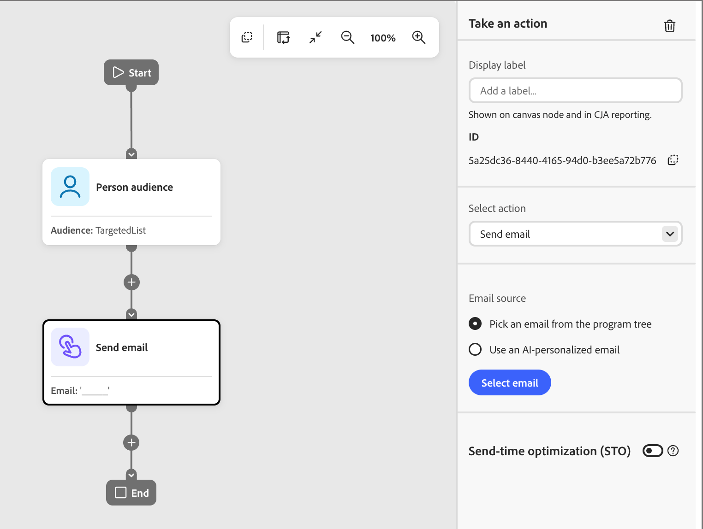{width="600"}

   Il nodo mostra un nome e-mail vuoto fino a quando non scegli un’e-mail.

1. Fai clic su **[!UICONTROL Seleziona e-mail]**.

   * **_E-mail struttura programma:_** Nella finestra di dialogo _[!UICONTROL Seleziona e-mail]_, individua e seleziona l&#39;e-mail.

     Utilizza **[!UICONTROL Ricerca e-mail]** per filtrare, se necessario. Seleziona un messaggio e-mail nell’elenco per visualizzarne l’anteprima e controllare l’oggetto.

     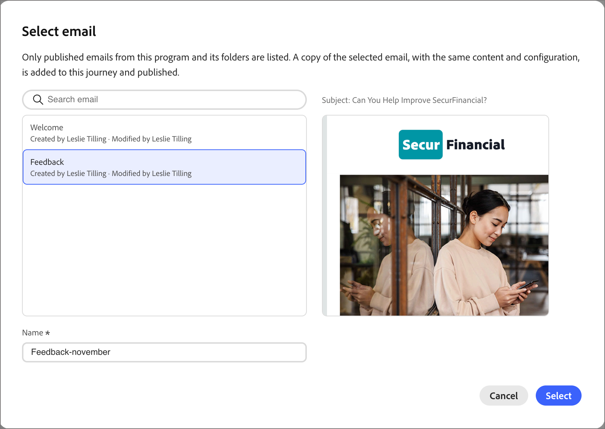{width="600" zoomable="yes"}

     >[!NOTE]
     >
     >La finestra di dialogo elenca solo le e-mail pubblicate dal programma di percorso e dalle relative cartelle. Le bozze non vengono visualizzate finché non vengono [pubblicate](#publish-email). Se un’e-mail non viene visualizzata, verifica che sia pubblicata (icona verde) e che si trovi nel programma corretto.

     In **[!UICONTROL Nome]**, immettere il nome che l&#39;e-mail deve avere all&#39;interno del percorso.

     Viene utilizzato il nome originale seguito da `_copy`. Rinominalo in qualcosa che abbia senso nel contesto del percorso.

   * **_E-mail personalizzata dall&#39;IA:_** Nella finestra di dialogo _[!UICONTROL Seleziona un&#39;e-mail generata dall&#39;IA]_, individua e seleziona l&#39;e-mail personalizzata.

     Seleziona un’e-mail personalizzata dall’elenco. La finestra di dialogo elenca le _e-mail personalizzate ai_ memorizzate nella libreria AI. Per ulteriori informazioni, consulta Personalizzare il contenuto delle e-mail per utente tipo.

     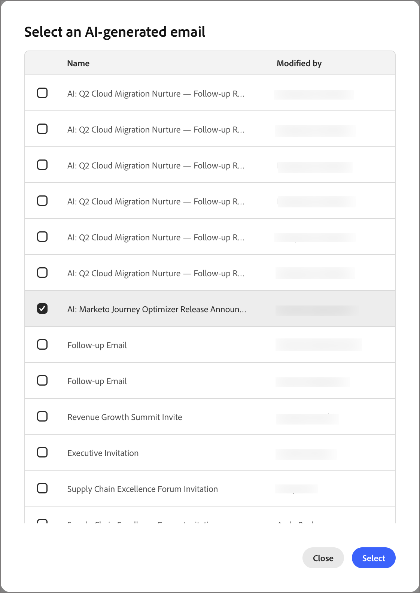{width="450" zoomable="yes"}

1. Fai clic su **[!UICONTROL Seleziona]**.

### Copia e-mail percorso {#journey-copy}

La copia viene aggiunta al percorso, pubblicata ed elencata sotto il percorso nella struttura dei programmi con un&#39;icona arancione. Ha un proprio ID azione ed è di sola lettura.

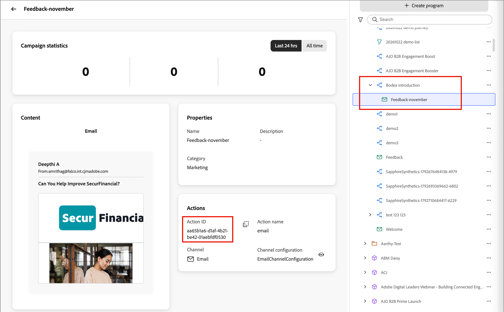{width="700" zoomable="yes"}

Il percorso conserva la propria copia. Il contenuto e la configurazione vengono copiati nel momento in cui selezioni l’e-mail. Se successivamente si duplica e si modifica l&#39;originale, i percorsi esistenti continuano a inviare la versione copiata.

Per l&#39;[ottimizzazione dell&#39;ora di invio](email-send-time-optimization.md) facoltativa, configurare il nodo dell&#39;azione di percorso dopo aver selezionato l&#39;e-mail.

### Aggiornare un’e-mail in un percorso {#update-email-in-journey}

Poiché la copia del percorso è di sola lettura, è possibile sostituirla anziché modificarla.

1. [Duplica](#duplicate-email) l&#39;e-mail originale pubblicata, apporta le modifiche alla bozza e [pubblicala](#publish-email).

1. Nel percorso, seleziona il nodo _Invia e-mail_ ed eliminalo utilizzando l&#39;icona del cestino nel pannello _Esegui un&#39;azione_.

1. Aggiungi al suo posto una nuova azione _Invia e-mail_ e seleziona l&#39;e-mail aggiornata.

## Ottimizzare la dimensione dell’HTML dell’e-mail {#optimize-html-size}

>[!CONTEXTUALHELP]
>id="ajo-b2b-prime_email_minification"
>title="Riduci la dimensionie dell’HTML"
>abstract="Abilita questa opzione per comprimere l’HTML dell’e-mail durante la pubblicazione rimuovendo spazi vuoti, rientri e commenti non essenziali non necessari. Questo aiuta a prevenire il clipping delle e-mail in client come Gmail. Gmail tronca i messaggi superiori a 100 KB."

[!DNL Marketo Optimizer] consente di comprimere la versione di e-mail HTML durante il processo di pubblicazione rimuovendo spazi vuoti, rientri e commenti non essenziali. Le dimensioni ridotte di HTML consentono di:

* Evita **il ritaglio e-mail**. Alcuni client, ad esempio Gmail, troncano i messaggi di dimensioni superiori a ~100 KB, impedendo ai destinatari di visualizzare l&#39;intero contenuto.
* Migliora il **tempo di caricamento e-mail** nella casella in entrata del destinatario.
* Migliora il recapito messaggi **1} e riduci l&#39;utilizzo della larghezza di banda.**

Questa ottimizzazione non viene applicata automaticamente. Abilitarla nella scheda _[!UICONTROL Contenuto]_.

<!--  -->

>[!IMPORTANT]
>
> La riduzione della dimensione del HTML viene applicata solo al momento della pubblicazione.

L’ottimizzazione è sicura per il client e-mail:

* Mantiene i commenti condizionali di MSO/Outlook.
* Non altera il contenuto effettivo, le immagini o i video.

>[!NOTE]
>
>La riduzione delle dimensioni dell’e-mail dipende dalla struttura HTML originale dell’e-mail. Se il contenuto è già compatto o il payload dell’e-mail è molto grande, la riduzione può essere minima e non impedire completamente il clipping.

<!-- 
Proof and simulate workflows are not available in this release. See [Current limitations](#limitations).

### Test HTML size optimization {#optimize-html-proof}

If you have enabled the [HTML size optimization](#optimize-html-size) option, you can evaluate its impact before publishing when sending proofs. Follow the following steps.

1. In the email design space, click the _Issues_ icon on the top right. If the rendered email size exceeds 100 KB, a message is displayed to warn you that this may cause truncation in some email clients.

1. Click **[!UICONTROL Simulate content]**.

1. To test the optimized version, click the **[!UICONTROL Send proof]** button and select the **[!UICONTROL Optimize HTML size]** option. This will send a proof with the reduced HTML size to your test recipients.

    >[!NOTE]
    >
    >This setting is independent from the email editor — the proof reflects what you select in the proof, regardless of whether the option is enabled or disabled in the email itself.

1. Select the test recipients and click **[!UICONTROL Send proof]**.

1. Back in the **[!UICONTROL Simulate]** screen, click the **[!UICONTROL View Proof]** button.

1. Click the _Information_ icon next to the status of the proof.

   The optimization details are displayed in a pop-up window, including the original HTML size, the optimized HTML size, and the size reduction percentage.
    
    Use this information to validate the optimized output and confirm the email stays within the recommended 100 KB threshold before publishing.

-->
