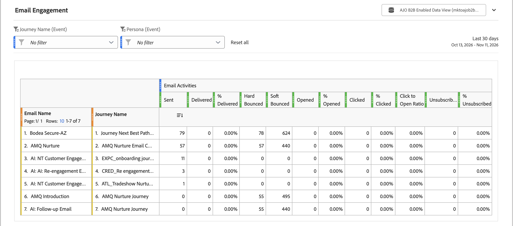
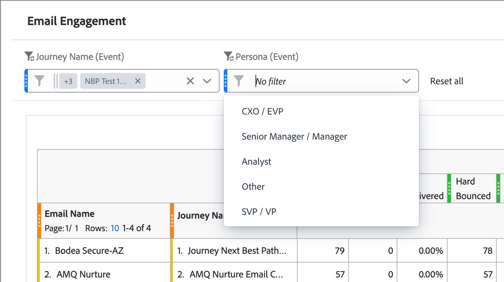

# Rapporto di coinvolgimento e-mail

<!-- SPHR-32511: Filter by Program, Filter by Audience, and the program data point for the email performance table are not documented here pending delivery. -->

Utilizza il rapporto [!UICONTROL Coinvolgimento e-mail] per rivedere il recapito messaggi e le prestazioni del coinvolgimento nell&#39;istanza, suddivisi per e-mail e percorso.

_Per visualizzare il report :_

1. Nel menu di navigazione a sinistra, seleziona **[!UICONTROL Rapporti]**.
1. Fai clic sull&#39;icona _Elenco_ (  ) e seleziona **[!UICONTROL Coinvolgimento e-mail]** nel pannello _[!UICONTROL Sommario]_.

{width="700" zoomable="yes"}

Utilizza i filtri **[!UICONTROL Nome Percorso (Evento)]** e **[!UICONTROL Persona (Evento)]** nella parte superiore del report per restringere i dati e-mail. Aprire un elenco di filtri e selezionare i valori da includere. Vedi [Filtri](#filters).

Puoi [modificare l&#39;intervallo di date](./reports-overview.md#change-the-date-range) utilizzando lo stesso selettore di intervalli di date disponibile in altre sezioni del rapporto.

Seleziona **[!UICONTROL Condividi]** nella parte superiore del report per scaricare o pianificare l&#39;esportazione di tutti i dati del report. Vedi [_Esportare un report_](./reports-overview.md#export-a-report) nella panoramica dei report.

## Tabella report {#report-table}

Il report [!UICONTROL Email Engagement] mostra una riga per ogni e-mail, con le seguenti dimensioni di riga.

* **[!UICONTROL Nome e-mail]** - Nome dell&#39;e-mail.
* **[!UICONTROL Nome Percorso]** - Nome del percorso che ha inviato l&#39;e-mail.

Le colonne delle metriche sono raggruppate in **[!UICONTROL Attività e-mail]**.

| Colonna | Descrizione |
| --- | --- |
| [!UICONTROL Inviato] | Numero di e-mail inviate. |
| [!UICONTROL Consegnato] | Numero di e-mail consegnate. |
| [!UICONTROL % recapitato] | Percentuale di e-mail inviate consegnate. |
| [!UICONTROL Notifica di mancato recapito] | Numero di e-mail che non sono state consegnate in modo permanente. |
| [!UICONTROL Rimbalzo morbido] | Numero di e-mail che al momento non sono state consegnate. |
| [!UICONTROL Aperto] | Numero di volte in cui i destinatari hanno aperto l’e-mail. |
| [!UICONTROL % aperto] | Percentuale di e-mail consegnate aperte. |
| [!UICONTROL Selezionato] | Numero di volte in cui i destinatari hanno fatto clic su un collegamento nell’e-mail. |
| [!UICONTROL % clic] | Percentuale di e-mail consegnate che hanno ricevuto un clic. |
| [!UICONTROL Fare clic per aprire la proporzione] | Percentuale di e-mail aperte che hanno ricevuto un clic. |
| [!UICONTROL Abbonamento annullato] | Numero di destinatari che hanno annullato l’abbonamento all’e-mail. |
| [!UICONTROL % ha annullato l&#39;abbonamento] | Percentuale di e-mail consegnate che hanno comportato l’annullamento dell’abbonamento. |

## Filtri {#filters}

Utilizza i filtri per restringere il rapporto per percorso o persona.

* **[!UICONTROL Nome Percorso (Evento)]** - Filtra in base al percorso che ha inviato l&#39;e-mail. Il valore predefinito è [!UICONTROL Nessun filtro].
* **[!UICONTROL Persona (Evento)]** - Filtra in base alla [persona derivata](../audiences/personas.md#filter-by-derived-persona) associata all&#39;e-mail. Il valore predefinito è [!UICONTROL Nessun filtro].

{width="500" zoomable="yes"}

Seleziona **[!UICONTROL Reimposta tutto]** per cancellare ogni filtro e tornare alla visualizzazione predefinita.