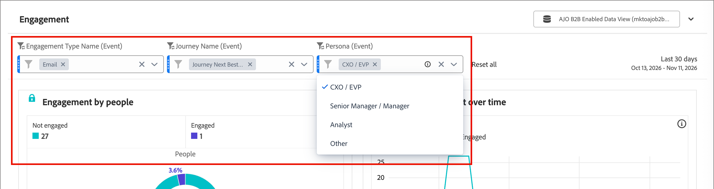

# Rapporto sul coinvolgimento

Utilizza il rapporto [!UICONTROL Coinvolgimento] per esaminare il modo in cui le persone si impegnano con i tuoi programmi di marketing, inclusi i trend di coinvolgimento per persona e coinvolgimento nel tempo.

_Per visualizzare il report :_

1. Nel menu di navigazione a sinistra, seleziona **[!UICONTROL Rapporti]**.
1. Fai clic sull&#39;icona _Elenco_ (  ) e seleziona **[!UICONTROL Coinvolgimento]** nel pannello _[!UICONTROL Sommario]_.

## Riquadri di rapporti {#report-tiles}

Il report [!UICONTROL Coinvolgimento] include due sezioni.

* **[!UICONTROL Coinvolgimento da parte di persone]** - Mostra il coinvolgimento tra le persone nella tua istanza.
* **[!UICONTROL Coinvolgimento della persona nel tempo]** - Mostra come cambia il coinvolgimento delle persone nel tempo.

{width="700" zoomable="yes"}

È possibile [modificare l&#39;intervallo di date](./reports-overview.md#change-the-date-range) per ogni riquadro del report.

Seleziona **[!UICONTROL Condividi]** nella parte superiore del report per scaricare o pianificare l&#39;esportazione di tutti i dati del report. Vedi [_Esportare un report_](./reports-overview.md#export-a-report) nella panoramica dei report.

## Filtri {#filters}

Utilizza i filtri nella parte superiore del rapporto per restringere i dati del coinvolgimento. Aprire un elenco di filtri e selezionare i valori da includere.

* **[!UICONTROL Nome tipo di coinvolgimento (evento)]** - Filtra in base al tipo di coinvolgimento, ad esempio e-mail. Il valore predefinito è [!UICONTROL Nessun filtro].
* **[!UICONTROL Nome Percorso (evento)]** - Filtra in base al percorso associato al coinvolgimento. Il valore predefinito è [!UICONTROL Nessun filtro].
* **[!UICONTROL Persona (evento)]** - Filtra in base alla [persona derivata](../audiences/personas.md#filter-by-derived-persona) associata al coinvolgimento. Il valore predefinito è [!UICONTROL Nessun filtro].

{width="500" zoomable="yes"}

Seleziona **[!UICONTROL Reimposta tutto]** per cancellare ogni filtro e tornare alla visualizzazione predefinita.
