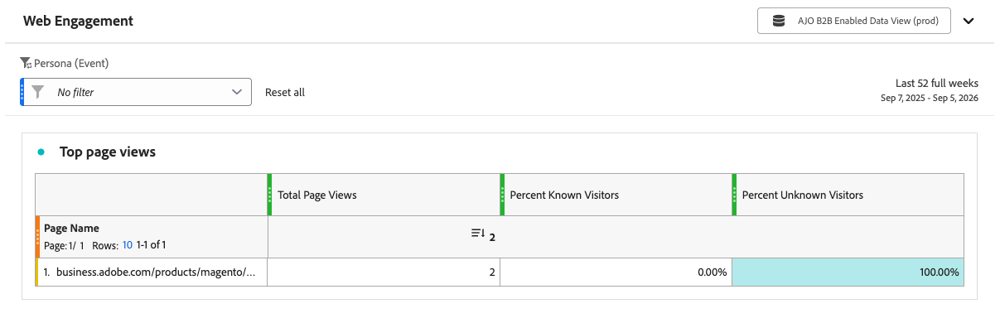
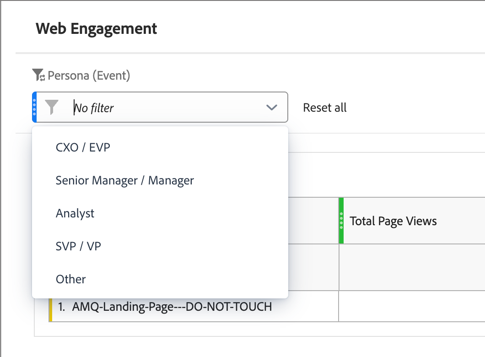

# Rapporto di coinvolgimento web

<!-- SPHR-39571: Audience, Company Name, Company Industry, and Region filters, plus the report title/subtitle rename, are planned under SPHR-32471 (not yet shipped) and should be documented separately once delivered  -->

Utilizza il rapporto [!UICONTROL Coinvolgimento web] per esaminare il coinvolgimento per i webinar interattivi più popolari nell&#39;istanza.

_Per visualizzare il report :_

1. Nel menu di navigazione a sinistra, seleziona **[!UICONTROL Rapporti]**.
1. Fai clic sull&#39;icona _Elenco_ (  ) e seleziona **[!UICONTROL Coinvolgimento Web]** nel pannello _[!UICONTROL Sommario]_.

{width="700" zoomable="yes"}

È possibile [modificare l&#39;intervallo di date](./reports-overview.md#change-the-date-range) per il report.

Seleziona **[!UICONTROL Condividi]** nella parte superiore del report per scaricare o pianificare l&#39;esportazione di tutti i dati del report. Vedi [_Esportare un report_](./reports-overview.md#export-a-report) nella panoramica dei report.

## Tabella report {#report-table}

Il report [!UICONTROL Web Engagement] mostra le prime 10 pagine più visualizzate nell&#39;istanza, con la dimensione riga seguente.

* **[!UICONTROL Nome pagina]** - Nome della pagina Web.

| Colonna | Descrizione |
| --- | --- |
| [!UICONTROL Visualizzazioni pagina totali] | Numero totale di visualizzazioni per la pagina. |
| [!UICONTROL Visitatori noti] | Percentuale di visualizzazioni da visitatori noti. |
| [!UICONTROL Visitatori sconosciuti] | Percentuale di visualizzazioni da visitatori sconosciuti. |

## Filtri {#filters}

Utilizza il filtro **[!UICONTROL Persona (Evento)]** nella parte superiore del report per limitare i dati di visualizzazione della pagina. Apri l’elenco dei filtri e seleziona i valori da includere.

* **[!UICONTROL Persona (evento)]** - Filtra in base alla [persona derivata](../audiences/personas.md#filter-by-derived-persona) associata alle visualizzazioni di pagina. Il valore predefinito è [!UICONTROL Nessun filtro].

{width="500" zoomable="yes"}

Selezionare **[!UICONTROL Reimposta tutto]** per cancellare il filtro e tornare alla visualizzazione predefinita.

>[!NOTE]
>
>I filtri per pubblico, nome della società, settore aziendale e area geografica sono pianificati per una versione futura.
